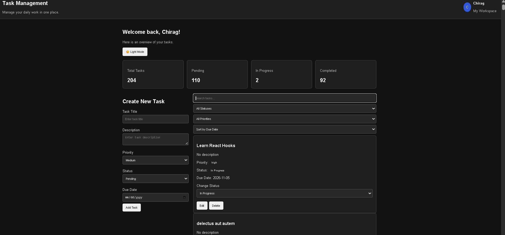
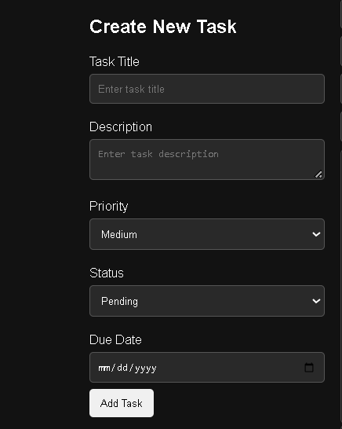
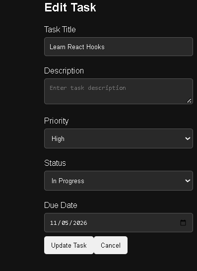

# Task Management Dashboard

## About the Project

This project is a Task Management Dashboard built using React.js and Redux Toolkit. It helps users create, view, edit, delete, and manage tasks in one place.

## Features

- Add new tasks
- View all tasks
- Edit existing tasks
- Delete tasks with a confirmation message
- Add task title and description
- Set task priority
- Set task status
- Add a due date
- Search tasks by title
- Filter tasks by status and priority
- Sort tasks
- View task summary
- Save tasks in local storage
- Fetch sample tasks from an API
- Responsive user interface

## Technologies Used

- React.js
- Redux Toolkit
- React Redux
- JavaScript
- HTML
- CSS
- Vite
- JSONPlaceholder API

## Project Setup

### 1. Clone the Repository

```bash
git clone https://github.com/ThakorChirag2005/task-management-dashboard-01.git
```

### 2. Open the Project Folder

```bash
cd task-management-dashboard-01
```

### 3. Install Dependencies

```bash
npm install
```

### 4. Start the Development Server

```bash
npm run dev
```

Open the local URL shown in the terminal to view the application in your browser.

## How Redux Toolkit Is Used

Redux Toolkit is used to manage task data in one central store.

- `store.js` creates the Redux store.
- `tasksSlice.js` manages task data and actions.
- `useSelector` reads data from the Redux store.
- `useDispatch` dispatches actions to update task data.
- `Provider` makes the Redux store available to React components.

The project uses Redux Toolkit to manage task operations such as adding, editing, deleting, and updating tasks.

## Task Validation

- The task title is required.
- A valid due date is required.

## Project Structure

```text
src/
├── app/
│   └── store.js
├── components/
│   ├── Header.jsx
│   └── ConfirmDialog.jsx
├── features/
│   └── tasks/
│       ├── tasksSlice.js
│       ├── TaskForm.jsx
│       ├── TaskList.jsx
│       ├── TaskItem.jsx
│       ├── TaskFilters.jsx
│       └── TaskSummary.jsx
├── App.jsx
├── App.css
├── index.css
└── main.jsx

screenshots/
├── dashboard.png
├── create-task.png
└── edit-task.png
```

## Screenshots

### Dashboard



### Create Task



### Edit Task



## Git Repository

GitHub Repository: https://github.com/ThakorChirag2005/task-management-dashboard-01

## Author

Chiragkumar Sureshbhai Thakor